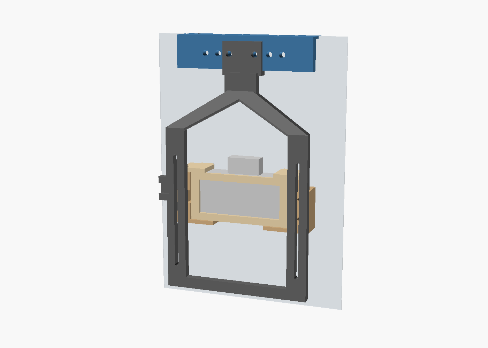

# P1S door holder for a Yonvim DC339 dash cam

A printed bracket that holds a Yonvim DC339 / DC339CT (Style-B) against the **outside** of the Bambu Lab P1S glass door. The same door is on the X1 series. The lens faces the glass, the screen faces the room, and the door still opens.

The bracket hangs from the two screws in the upper hinge bar (the part stamped SJ-TOP). Nothing is drilled.



The pale sheet in the picture is the glass. The gray block is the camera. In real life the lens is pressed up to that glass.

## Before you print: check the focus

The manual says this camera may not focus on anything closer than about 2 meters. The bed is much closer than that. Power the camera, hold it against the door by hand, and look at the screen.

- If the plate texture is sharp, print the mount.
- If it is soft, the lens is usually a threaded cell with a drop of glue on it. While the live view shows the bed, turn the lens a few degrees at a time. Closer focus is a small turn outward. When the texture is sharp, lock it with a speck of nail polish. If the lens will not turn, leave it alone. The mount will still hold the camera, but the print will stay soft.

## What to print

Sized for the listed body: 92 mm wide, 43 mm tall, 21 mm thick. The flip-up windshield bracket is not part of that height. It sticks out through the open middle of the top.

| File | How many | Bed face |
| --- | --- | --- |
| `stl/hinge_rail.stl` | 1 | flat flange down, no supports |
| `stl/drop_arm.stl` | 1 | the two long rails down. Tree supports under the raised hook |
| `stl/cradle.stl` | 1 | flat floor down, no supports |
| `stl/back_retainer.stl` | 1 | flat plate down, no supports |
| `stl/pin.stl` | 2 | flat, no supports |
| `stl/shim_1.5mm.stl` | 2, only if you need them | flat |
| `stl/shim_3mm.stl` | 2, only if you need them | flat |
| `stl/shim_6mm.stl` | 2, only if you need them | flat |

PETG, black if you have it. 0.2 mm layers, 4 walls, 30% gyroid. The mount lives outside the chamber, so PLA will survive, but the glass gets warm and PETG holds its shape better. The arm is 227 mm long and fits the P1S plate along X.

If the body measures closer to 35 mm thick once the lens is included, print `drop_arm_deep.stl`, `cradle_deep.stl`, and `back_retainer_deep.stl` instead of the three standard parts. The rail, pins, and shims stay the same. Those deep parts are generated for a 36 mm body.

## Screws

- 2× M3 button or pan head, for the hinge. Try M3×8 first. If the head does not clamp the rail, use M3×10. If a screw stops turning before the head is tight, it has bottomed out: back it off and add a washer. Do not force it. The stock screws are too short once the 2 mm rail is added.
- 4× M3×16 and 4× M3 nuts for the cradle. Use M3×20 if you stack shims. Nyloc nuts are worth it. The printer vibrates.

## Assembly

1. Hold the door while you work. Take out one hinge screw, then the other. Do not let the glass drop.
2. Put the rail on the door so the slot lines up with both screw holes and the lip hangs down the **outside** of the door. The rail can slide along the slot. The slot accepts screw centers up to 100 mm apart.
3. Snug the two M3 screws. Close the door and confirm the extra 2 mm still lets it shut.
4. Slide the arm onto the lip from either end. Line up a pair of pin holes (they step every 12 mm) and push both pins in from the room side.
5. Stick a small square of the spare dash-cam adhesive pad on each front post so the plastic does not scratch the glass.
6. Cut a hole in another pad and stick it around the lens, as a hood against the glass. That kills most of the reflection.
7. Slide the camera in from the room side. Lens toward the posts, flip bracket through the top opening, USB-C out the bottom notch.
8. Set the retainer over the back. Drop a pin through each top hole into the boss. The hole is already in the position that fits a 21 mm body, with about 3 mm of room behind the camera. If it rattles, put a pad on the inside of the retainer.
9. Bolt the cradle to the two slots in the arm. No shims at first. Slide it until the posts just touch the glass and the bed is in frame, then tighten. The slots are the height adjustment.
10. If the posts hit the glass before the cradle can sit flat on the arm, add the same shim stack behind both pads.
11. Open the door by hand once. The arm swings up with it. Make sure it clears an AMS or anything else on top of the printer, and leave a loop of slack in the USB cable.

## Recording a timelapse

Plug the camera into any 5 V USB supply that can do about 1.5 A. It starts recording when power shows up and stops when you unplug it. Plug in as the print starts.

In the menu:

- Resolution: 2.5K
- Loop recording: 3 minutes
- Time-lapse: **off**. That setting is the parking monitor. It grabs a frame every few seconds only when the camera thinks the car is off, and it wants a hardwire kit. It is not the timelapse you want.
- G-sensor: **off**. Vibration locks files, and locked files are never overwritten. The card fills up and recording stops.
- Record audio: off
- Date stamp: off, if you want a clean picture
- Screen saver: 10 seconds

A four-hour print is on the order of 30–40 GB at a normal dash-cam bitrate, so the 64 GB card covers it. Clips are `.TS` files.

Speed them up with ffmpeg. `120` means 120×: four hours becomes two minutes. Use `60` if you want a longer video.

```bash
printf "file '%s'\n" *.TS > list.txt
ffmpeg -f concat -safe 0 -i list.txt -an \
  -vf "setpts=PTS/120,fps=30" \
  -c:v libx264 -crf 18 timelapse.mp4
```

The lens is about 160° across and only about 65° tall, so the print sits in the middle of a wide frame. Crop it. Slide the cradle up or down until both the bed and the top of the print are in that vertical view. The chamber light should keep the picture in color. If it flips to black and white or washes out, night vision is bouncing off the glass. Cover any infrared LEDs next to the lens with tape.

## If the camera does not fit

Measure three numbers, in millimeters:

- width across the screen
- height of the body, not counting the flip bracket
- thickness at the thickest point, including the lens

Edit `camera_w`, `camera_h`, and `camera_d` at the top of `p1s_dashcam_mount.scad`, then export again:

```bash
openscad -D 'part="cradle"' -o cradle.stl p1s_dashcam_mount.scad
```

`part` is one of `rail`, `arm`, `cradle`, `retainer`, `shim`, `pin`.

If the two hinge screws are more than 100 mm apart, raise `slot_len` and keep `rail_len` at least 28 mm longer than the slot.
